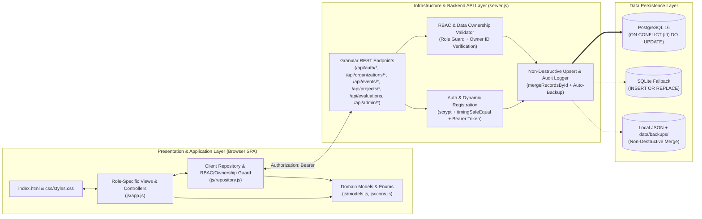

# ARCHITECTURE DOCUMENTATION — CAMPUS IMPACT HUB
**Versi:** 2.2.0 (Complete Multi-Role Web Application, Non-Destructive Upsert, `scrypt` Auth, RBAC & Data Ownership)

---

## 1. Gambaran Umum Arsitektur

**Campus Impact Hub** menerapkan arsitektur **Full-Stack Web Single Page Application (SPA)** dengan **Node.js REST API Server** yang menegakkan:
1. **Non-Destructive Multi-Tier Persistence**: Seluruh operasi tulis ke PostgreSQL 16 (`INSERT ... ON CONFLICT (id) DO UPDATE`), SQLite (`INSERT OR REPLACE INTO`), dan Local JSON (`mergeRecordsById` + pre-write backup di `data/backups/`) bebas dari operasi `DELETE FROM` massal.
2. **Server-Side Authentication (`crypto.scryptSync` + `crypto.timingSafeEqual`) & Session Bearer Token**: Login dan registrasi multi-role dinamis diproses penuh di backend.
3. **Centralized RBAC & Data Ownership Validation**: Setiap endpoint API memvalidasi peran pengguna (`student`, `organization`, `partner`, `admin`) sekaligus kepemilikan data (`ownerUserId`, `organizationId`, `studentId`).
4. **Digital Event Registration & Manual Attendance Validation (Tanpa QR Code)**: Seluruh modul QR (`js/qr.js`, QR Ticket, QR Scanner) dihapus dan diganti dengan pencatatan registrasi peserta relasional (`event_registrations`) serta validasi kehadiran manual oleh panitia organisasi berdasarkan pencarian **Nama atau NIM**.

---

## 2. Daftar Endpoint REST API & Validasi Keamanan

| Endpoint | Method | Role yang Diizinkan | Validasi Kepemilikan Data (Ownership) & Aturan Bisnis |
| :--- | :---: | :---: | :--- |
| `/api/health` | `GET` | Publik | Melaporkan status `scrypt`, RBAC + Ownership, non-destructive upsert, dan jumlah baris tabel. |
| `/api/state` | `GET` | Publik / Auth | Mengembalikan state aplikasi yang telah disanitasi (`sanitizeUser` menghapus field `password`). |
| `/api/state` | `PUT` | Terautentikasi | Memvalidasi Bearer Token + `validateStateMutationRbac` (menolak mutasi lintas role/kepemilikan dengan `403`). |
| `/api/auth/login` | `POST` | Publik | Verifikasi `scrypt` hash, cek `accountStatus === 'Active'`, terbitkan Bearer Token, catat di `auditLogs`. |
| `/api/auth/register` | `POST` | Publik (Non-Admin) | Registrasi dinamis `student`, `organization`, `partner` (`admin` ditolak `403`). Validasi keunikan Email & NIM (`409`), format/ukuran SK, hash `scrypt`. |
| `/api/auth/logout` | `POST` | Terautentikasi | Menghapus token sesi aktif dan mencatat `AUTH_LOGOUT` di `auditLogs`. |
| `/api/auth/me` | `GET` | Terautentikasi | Mengembalikan profil pengguna pemilik token sesi aktif. |
| `/api/auth/change-password` | `POST` | Terautentikasi | Memverifikasi sandi lama dengan `scrypt` dan memperbarui hash sandi baru milik pengguna sendiri. |
| `/api/profile` | `PUT` | Terautentikasi | Hanya memperbarui profil milik pengguna sendiri (`auth.user.id`); memblokir perubahan `role` atau skor. |
| `/api/organizations` | `POST` | `organization`, `admin` | Organisasi hanya dapat membuat/memperbarui data organisasinya sendiri (`isOrganizationOwnedByUser`). Perubahan SK pada organisasi terverifikasi memicu status `PENDING`. |
| `/api/organizations/verify` | `POST` | `admin` | Menyetujui (`VERIFIED`) atau menolak (`REJECTED` wajib disertai alasan tertulis) pendaftaran SK organisasi. |
| `/api/events` | `POST`/`PUT` | `organization`, `admin` | Organisasi wajib berstatus `VERIFIED` untuk mempublikasikan event resmi dan hanya dapat mengedit event miliknya sendiri (`isEventOwnedByUser`). |
| `/api/events/register` | `POST` | `student` | Mendaftarkan/membatalkan pendaftaran mahasiswa sendiri (`auth.user.id`), cek kapasitas & duplikasi (`409`). Tidak memberikan poin saat baru mendaftar. |
| `/api/events/validate-attendance` | `POST` | `organization`, `admin` | Organisasi hanya dapat memvalidasi kehadiran peserta pada event miliknya sendiri (`isEventOwnedByUser`). Mencari peserta via Nama/NIM, mencegah duplikasi (`409`), dan menerbitkan poin kontribusi (`+10` / `+20`). |
| `/api/projects` | `POST`/`PUT` | `partner`, `admin` | Pengajuan masalah UMKM otomatis berstatus `SUBMITTED` (masuk review Admin). UMKM hanya dapat memperbarui proyek miliknya sendiri (`isProjectOwnedByUser`) dan tidak dapat menyetujui sendiri ke `OPEN`. |
| `/api/projects/apply` | `POST` | `student` | Mahasiswa mendaftar pada proyek `OPEN`, dicek duplikasi (`409`). Poin diberikan saat proyek selesai (`COMPLETED`). |
| `/api/evaluations` | `POST` | `partner`, `admin` | UMKM hanya dapat menilai mahasiswa yang ditugaskan pada proyek miliknya sendiri (`isProjectOwnedByUser`), 5 kriteria (1–5), cegah duplikasi (`409`). |
| `/api/admin/users` | `PUT` | `admin` | Mengubah status akun (`Active`, `Inactive`, `Suspended`) dan informasi mahasiswa, tercatat di `auditLogs`. |
| `/api/admin/system-config` | `PUT` | `admin` | Mengelola konfigurasi batas ukuran/format upload dan pengaturan sistem. |
| `/api/demo` & `/api/reset` | `POST` | `admin` | Memuat data demo secara non-destruktif atau mereset data operasional dengan backup otomatis ke `data/backups/`. |
