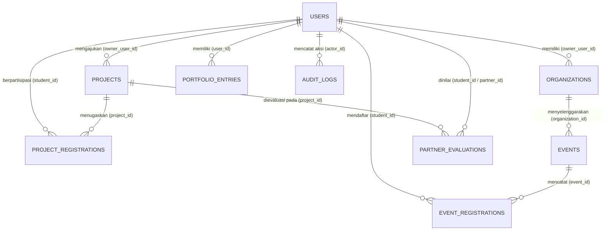

# DATA MODEL SPECIFICATION — CAMPUS IMPACT HUB
**Versi:** 2.2.0 (Relational Multi-Role Entities, No Open Recruitment, No QR Ticket)

---

## 1. Diagram Entitas & Relasi (ERD)

---

## 2. Spesifikasi Tabel & Koleksi Data

### 2.1 `users` (Akun Pengguna & Profil Peran)
* `id` (PK): ID unik pengguna (`U-MHS-001`, `U-BEM-003`, `U-MTR-004`, `U-DSN-002`, `U-REG-*`)
* `name`: Nama lengkap mahasiswa / nama organisasi / nama usaha UMKM / nama dosen
* `email` (Unique): Email akun
* `identityNumber`: NIM (unik untuk mahasiswa) / NIP / Nomor Identitas Mitra
* `password`: Hash kriptografis `scrypt$<salt_hex>$<hash_hex>` (**Server-Only**, selalu dihapus oleh `sanitizeUser()` sebelum dikirim ke client)
* `role`: `'student'` | `'organization'` | `'partner'` | `'admin'` (permanen setelah registrasi)
* `accountStatus`: `'Active'` | `'Inactive'` | `'Suspended'`
* `faculty`, `studyProgram`, `majorOrUnit`, `phone`, `ownerName`, `address`, `bio`
* `impactScore`, `leadershipScore`, `projectsCompleted`, `umkmHelped`, `beneficiariesReached`, `contributionHours`

### 2.2 `organizations` (Registrasi Organisasi & Dokumen Legalitas SK)
* `id` (PK), `ownerUserId` (FK &rarr; `users.id`)
* `name`, `fullName`, `category`, `level` (`Universitas` | `Fakultas` | `Program Studi / Jurusan`), `affiliation`
* `chairmanName`, `advisorName`, `contact`, `activityField`, `description`
* `skNumber`: Nomor Surat Keputusan resmi
* `skDocumentName`, `skDocumentType`, `skDocumentSize`, `skDocumentData`: Referensi dan data dokumen SK (`PDF`, `JPG`, `JPEG`, `PNG`)
* `verificationStatus`: `'DRAFT'` | `'PENDING'` | `'VERIFIED'` | `'REJECTED'`
* `rejectionReason`: Alasan penolakan tertulis dari Admin Kampus

### 2.3 `events` (Agenda Event Kampus)
* `id` (PK), `organizationId` (FK &rarr; `organizations.id`), `ownerUserId` (FK &rarr; `users.id`)
* `title`, `organizerName`, `type`, `description`, `date`, `registrationDeadline`, `location`
* `quota`, `registeredCount`, `pointsReward` (`10`), `committeePointsReward` (`20`)
* `publicationStatus`: `'DRAFT'` | `'PENDING'` | `'PUBLISHED'` | `'REJECTED'`
* *(Seluruh field QR Ticket telah dihapus sepenuhnya)*

### 2.4 `event_registrations` (Registrasi Peserta & Validasi Kehadiran Manual)
* `id` (PK): `REG-<eventId>-<studentId>`
* `eventId` (FK &rarr; `events.id`), `studentId` (FK &rarr; `users.id`)
* `studentName`, `studentNim`, `faculty`, `studyProgram`, `roleInEvent` (`Participant` | `Committee`)
* `registrationStatus`: `'Registered'` | `'Cancelled'`
* `attendanceStatus`: `'Registered'` | `'Cancelled'` | `'Attended'` | `'No Show'`
* `registeredAt`, `checkInTimestamp`, `validatedBy`

### 2.5 `projects` (Pengajuan Masalah Mitra UMKM & Proyek Sosial)
* `id` (PK), `ownerUserId` (FK &rarr; `users.id`), `organizationName`, `ownerName`
* `title`, `description`, `category`, `location`, `expectedOutcomes`, `expectedDuration`, `attachmentName`
* `requirements` (JSON array), `milestones` (JSON array), `assignedStudents` (JSON array), `impactReport` (JSON object)
* `status`: `'SUBMITTED'` &rarr; `'UNDER_REVIEW'` &rarr; `'OPEN'` &rarr; `'ON_GOING'` &rarr; `'COMPLETED'` (atau `'REJECTED'`)
* `rejectionReason`, `verifiedByAdmin`

### 2.6 `project_registrations` (Partisipasi Mahasiswa pada Proyek Sosial)
* `id` (PK): `PRJ-REG-<projectId>-<studentId>`
* `projectId` (FK &rarr; `projects.id`), `studentId` (FK &rarr; `users.id`)
* `studentName`, `studentNim`, `faculty`, `studyProgram`, `roleInProject`
* `status`: `'APPROVED'`, `pointsAwarded`: `boolean`, `registeredAt`

### 2.7 `partner_evaluations` (Penilaian Kinerja Mahasiswa oleh Mitra UMKM)
* `id` (PK), `projectId` (FK &rarr; `projects.id`), `studentId` (FK &rarr; `users.id`), `partnerId` (FK &rarr; `users.id`)
* `ratings`: `{ workQuality, timeliness, communication, responsibility, objectiveAchievement }` (skala 1–5)
* `averageScore`, `comment`, `verifiedByAdmin`, `createdAt`

### 2.8 `portfolio_entries` (Transaksi Kontribusi Terverifikasi / Immutable)
* `id` (PK), `userId` (FK &rarr; `users.id`), `activityId`
* `title`, `organizationOrPartner`, `category`, `date`
* `impactPoints`, `leadershipPoints`, `verificationStatus`, `verifiedBy`, `outcomeSummary`, `credentialCode`, `createdAt`

### 2.9 `audit_logs` & `system_config`
* `audit_logs`: Mencatat setiap aktivitas login, registrasi, perubahan profil, verifikasi SK, publikasi event, validasi kehadiran, pengajuan/persetujuan proyek, evaluasi mahasiswa, dan perubahan status akun oleh Admin.
* `system_config`: Menyimpan konfigurasi batas ukuran upload (`maxUploadSizeKb`), format file yang diizinkan (`allowedUploadFormats`), dan aturan poin kontribusi.
